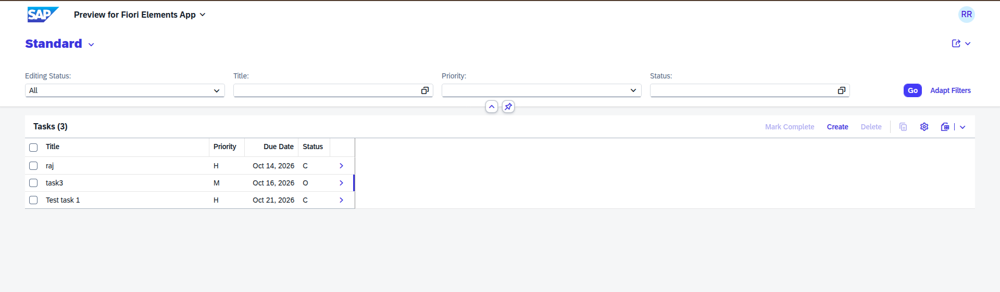
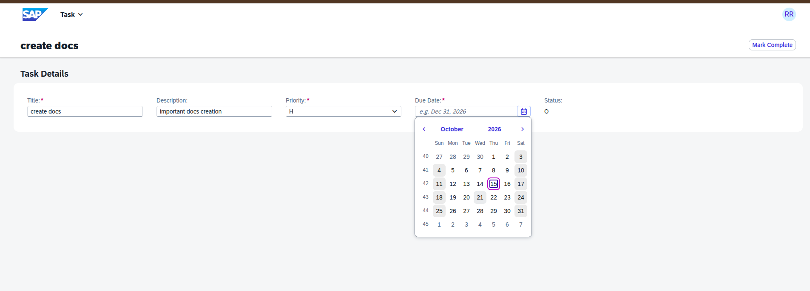
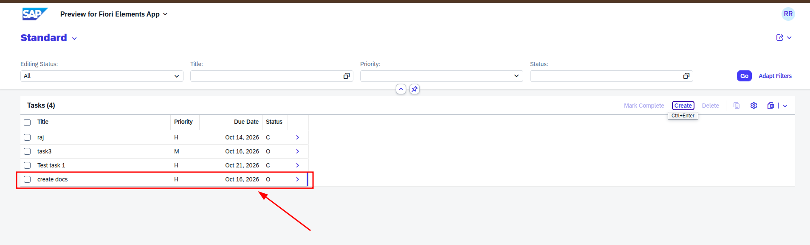
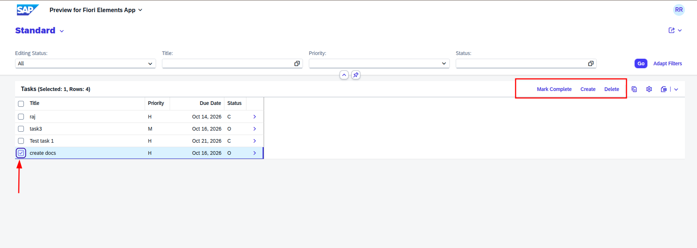

# Task Tracker – SAP RAP Application

A simple task management app built with the **ABAP RESTful Application Programming Model (RAP)** on SAP BTP ABAP Environment.

---

## Features

- Create, update, and delete tasks
- Set priority (High / Medium / Low) via a value help
- Mark tasks as **Complete** using a RAP action
- Input validation with meaningful error messages
- Fiori Elements List Report + Object Page UI

---

## Repository Structure

```
task-tracker-rap/
├── src/
│   ├── classes/                                     # ABAP Classes
│   │   ├── zbp_i_task.clas.abap                     # Behaviour pool (global shell)
│   │   ├── zbp_i_task.clas.locals_imp.abap          # Local handler (lhc_Task)
│   │   ├── zcl_tt_load_data.clas.abap               # Seed data loader (run with F9)
│   │   ├── zcl_tt_load_data.clas.locals_imp.abap    # Local types (if any)
│   │   ├── zcl_tt_test_task.clas.abap               # Console test runner (run with F9)
│   │   ├── zcl_tt_validator.clas.abap               # Due-date validator
│   │   ├── zcl_tt_validator.clas.locals_imp.abap    # Local types (if any)
│   │   └── zcl_tt_validator.clas.testclasses.abap   # ABAP Unit tests
│   ├── database-tables/                             # Dictionary Tables
│   │   ├── ztt_priority.tabl.txt                    # Priority master data
│   │   └── ztt_task.tabl.txt                        # Task table (with draft fields)
│   ├── data-definitions/                            # CDS Views
│   │   ├── zi_task.ddls.asddls                      # Interface view (root entity)
│   │   ├── zc_task.ddls.asddls                      # Projection / consumption view
│   │   └── zi_priority_vh.ddls.asddls               # Priority value help
│   ├── behavior-definitions/                        # BDEFs
│   │   ├── zi_task.bdef.asbdef                      # Interface BDEF (managed + draft)
│   │   └── zc_task.bdef.asbdef                      # Projection BDEF
│   ├── metadata-extensions/                         # UI Annotations
│   │   └── zc_task.ddlx.asddlxs                    # List report + object page layout
│   ├── access-controls/                             # DCLS
│   │   └── zi_task.dcls.asdcls                      # Authorization check
│   └── service-definitions/                         # Service / Binding
│       └── zui_task2.srvd.srvdsrv                   # OData V4 service definition
├── docs/
│   └── screenshots/                                 # App screenshots
│       ├── main_home.png
│       ├── create.png
│       ├── added_task.png
│       └── select_and_delete_or_complete.png
└── README.md
```

---

## Screenshots

### Home Screen – All Tasks
> The main list report showing all created tasks with their Title, Priority, Due Date, and Status.



---

### Create New Task
> The form to create a new task. Fills in Title, Description, Priority (value help), and Due Date.



---

### Add Task – Filled Fields
> Object page showing a task with all fields filled in — demonstrating input and validation in action.



---

### Select, Mark Complete & Delete
> Selecting one or more tasks from the list to either mark them as Complete or delete them.



---

## How to Run

1. Log on to your SAP BTP ABAP Environment system in **ADT (Eclipse)**.
2. Import or recreate all objects from the `src/` folder in the order below.
3. Activate all objects.
4. Publish the service binding **ZUI_TASK2_O4** and open the Fiori preview.

### Import Order

| # | Object | Type | Folder |
|---|--------|------|--------|
| 1 | `ZTT_PRIORITY` | Database Table | `database-tables/` |
| 2 | `ZTT_TASK` | Database Table | `database-tables/` |
| 3 | `ZCL_TT_LOAD_DATA` | ABAP Class (run F9) | `classes/` |
| 4 | `ZI_PRIORITY_VH` | CDS Value Help | `data-definitions/` |
| 5 | `ZI_TASK` | CDS Interface View | `data-definitions/` |
| 6 | `ZC_TASK` | CDS Projection View | `data-definitions/` |
| 7 | `ZI_TASK` (BDEF) | Behaviour Definition | `behavior-definitions/` |
| 8 | `ZC_TASK` (BDEF) | Behaviour Definition | `behavior-definitions/` |
| 9 | `ZBP_I_TASK` | Behaviour Pool Class | `classes/` |
| 10 | `ZCL_TT_VALIDATOR` | Validator Class | `classes/` |
| 11 | `ZC_TASK` (DDLX) | Metadata Extension | `metadata-extensions/` |
| 12 | `ZI_TASK` (DCLS) | Access Control | `access-controls/` |
| 13 | `ZUI_TASK2` | Service Definition | `service-definitions/` |

---

## Technologies Used

- SAP BTP ABAP Environment (Steampunk)
- ABAP RESTful Application Programming Model (RAP) with Draft
- Core Data Services (CDS)
- SAP Fiori Elements (List Report + Object Page)
- ABAP Unit Test

---

## Author

Rahul  
Built as a learning project following the RAP developer guide.
